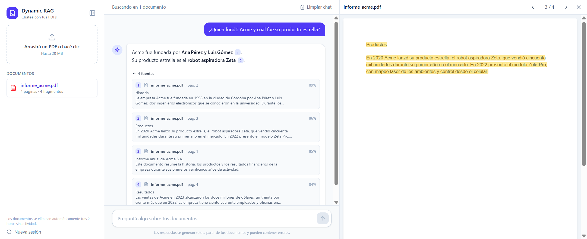
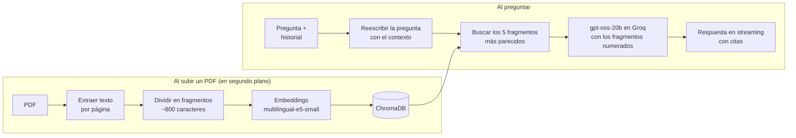

# Dynamic RAG

Subí uno o varios PDFs y hacele preguntas. Cada respuesta cita las páginas de donde sale, y al hacer clic en una cita el documento se abre en esa página con el fragmento resaltado.

**Demo:** https://dynamic-rag-five.vercel.app



## Funcionalidades

- **Respuestas con citas verificables.** Cada afirmación lleva un número `[n]`. Al hacer clic, el visor abre el PDF en esa página y resalta el fragmento exacto.
- **Streaming.** La respuesta aparece palabra por palabra.
- **Conversación con memoria.** Las preguntas de seguimiento ("¿y dónde nació?") se reescriben con el contexto de la charla antes de buscar.
- **Varios documentos.** Se puede buscar en todos o elegir en cuáles.
- **Procesamiento en segundo plano con progreso real.** Muestra los fragmentos procesados, la posición en la cola y el tiempo restante. Si se recarga la página, el progreso se retoma.
- **Sesiones anónimas y temporales.** No hay registro. Los documentos de cada visitante están aislados de los demás y se borran solos tras 2 horas sin actividad.
- **Validaciones con mensajes claros.** La app rechaza PDFs protegidos con contraseña, escaneados sin texto, de más de 300 páginas o de más de 20 MB.

## Cómo funciona



1. **Ingesta.** PyMuPDF extrae el texto de cada página, que se divide en fragmentos de unos 800 caracteres con 150 de superposición. Cada fragmento guarda su página de origen. Los embeddings se generan localmente con `intfloat/multilingual-e5-small`, un modelo multilingüe y liviano que anda bien en español, y se guardan en ChromaDB con la sesión y el documento como metadatos.
2. **Consulta.** Si hay historial, el LLM primero reescribe la pregunta para que se entienda sola. Por ejemplo, "¿y dónde nació?" pasa a ser "¿Dónde nació Víctor Jara?". Con esa versión se buscan los 5 fragmentos más similares, filtrando por la sesión y los documentos elegidos.
3. **Respuesta.** El LLM recibe los fragmentos numerados y la instrucción de responder solo con esa información, citando cada dato. El backend envía primero las fuentes y después los tokens por Server-Sent Events.

## Decisiones técnicas

| Decisión | Por qué |
|---|---|
| **Groq con `openai/gpt-oss-20b`** | Responde muy rápido (cientos de tokens por segundo) y tiene un plan gratis que alcanza para una demo. |
| **Embeddings locales** en lugar de una API | Sin costo por documento ni otra API key. Además, el documento completo no sale del servidor: al LLM solo llegan los 5 fragmentos de cada pregunta. |
| **ChromaDB** | Persistente en disco, con filtros por metadatos (sesión y documento) y sin un servicio aparte. |
| **Reescritura de la pregunta** | Sin ella, "¿y dónde nació?" busca literalmente esas palabras y no encuentra nada útil. |
| **Procesamiento en segundo plano** | Un PDF largo tarda minutos en la CPU del servidor, y los proxies cortan las peticiones largas. La subida responde enseguida (202) y el cliente consulta el avance. Los fragmentos se guardan juntos al final, así una búsqueda nunca ve un documento a medio procesar. |
| **Historial enviado por el cliente** | El backend no guarda estado de la conversación: cada pregunta trae su historial, recortado a los últimos 6 mensajes. |
| **Validación del tamaño mientras llega el archivo** | Un middleware ASGI corta la subida apenas pasa los 20 MB, en vez de recibir el archivo entero y recién después rechazarlo. |

## Stack

- **Backend:** Python, FastAPI, PyMuPDF, sentence-transformers, ChromaDB, Groq SDK.
- **Frontend:** React 19, TypeScript, Vite, Tailwind CSS 4, TanStack Query, react-pdf (pdf.js), react-markdown.
- **Tests:** pytest, Vitest y Playwright (E2E con video, en escritorio y celular).
- **Infraestructura:** Docker Compose, Caddy, AWS (EC2, CloudFront, SSM Parameter Store y CloudFormation) y Vercel.

## Correr en local

Requisitos: Python 3.10 o superior, Node 20.19 o superior y una API key de [Groq](https://console.groq.com/keys) (es gratis).

Los comandos son para **cmd** de Windows. En Linux o macOS, activá el entorno con `source .venv/bin/activate` y usá `cp` en lugar de `copy`.

**Backend** (http://localhost:8000, documentación de la API en `/docs`):

```
cd backend
python -m venv .venv
.venv\Scripts\activate
pip install -r requirements-dev.txt
copy .env.example .env
```

Completá `GROQ_API_KEY` en `backend\.env` y levantá el servidor:

```
uvicorn app.main:app --reload
```

La primera vez descarga el modelo de embeddings, que pesa unos 470 MB.

**Frontend** (http://localhost:5173), en otra consola:

```
cd frontend
npm install
npm run dev
```

Vite reenvía `/api` al backend local, así que no hace falta configurar nada más.

**Con Docker**, como en producción: backend y Caddy con HTTPS en https://localhost.

```
copy .env.example .env
docker compose up -d --build
```

## Tests

```
cd backend
.venv\Scripts\activate
pytest
```

```
cd frontend
npm test
npm run e2e:ui
npm run e2e
```

- `npm test` corre las pruebas unitarias con Vitest.
- `npm run e2e:ui` corre los tests E2E de interfaz, que no llaman al LLM.
- `npm run e2e` corre todos los E2E, incluidos los de calidad de respuestas, que sí usan la cuota de Groq.

- **Backend:** ingesta y casos borde de PDFs, chat con un LLM simulado, API de documentos, trabajos en segundo plano, limpieza de sesiones y límite de uso.
- **E2E:** levantan el backend y el frontend solos. Graban un video de cada test, que se ve con `npm run e2e:report`. Los PDFs de prueba se generan con `backend/scripts/make_test_pdfs.py`.

> En Windows, Vitest y `docker compose build` fallan si la ruta empieza con `c:\` en minúscula: abrí la consola en `C:\...`.

## Deploy

```
navegador ──HTTPS──► Vercel (frontend)
          ──HTTPS──► CloudFront ──HTTP──► EC2 t3.small: Caddy ──► FastAPI (Docker Compose)
```

Toda la infraestructura de AWS está en [`infra/cloudformation.yml`](infra/cloudformation.yml):

- **Una EC2 t3.small** (2 GB de RAM) con Ubuntu. En el primer arranque instala Docker, clona el repo y levanta la app como servicio de systemd.
- **CloudFront delante de la EC2.** Da HTTPS sin necesidad de un dominio propio. El puerto 80 de la instancia solo acepta tráfico de CloudFront, y el backend toma la IP real del usuario del encabezado `CloudFront-Viewer-Address`.
- **La API key de Groq** se guarda en SSM Parameter Store como SecureString. La instancia la lee al arrancar con un rol IAM de solo lectura, así que nunca queda escrita en la plantilla.
- **Sin SSH:** se entra con Session Manager.
- **La imagen de Docker** usa PyTorch solo para CPU, trae el modelo de embeddings incluido y arranca sin conexión a Hugging Face.

### Pasos

1. Crear el proyecto en Vercel con `frontend` como directorio raíz y anotar su URL.
2. En Systems Manager → Parameter Store, crear `/dynamic-rag/groq-api-key` de tipo **SecureString** con la API key.
3. En CloudFormation, crear un stack con `infra/cloudformation.yml`. Completar `CorsOrigin` con la URL de Vercel y `AlertEmail` con un email, y tildar el aviso de IAM. La app tarda de 5 a 10 minutos en estar lista; el output `HealthCheck` lo confirma.
4. En Vercel, definir `VITE_API_URL` con el output `BackendUrl` y volver a hacer el deploy.

Para actualizar el servidor después de un push, desde Session Manager:

```
cd /opt/dynamic-rag && sudo git pull && sudo systemctl restart dynamic-rag
```

## Limitaciones conocidas

- **Referencias exactas.** La búsqueda es solo semántica, así que preguntas como "¿qué dice el artículo 14?" pueden fallar. Una búsqueda híbrida (BM25 + vectores) lo resolvería.
- **Ideas cortadas entre fragmentos.** Si un párrafo largo queda dividido, la respuesta puede salir incompleta. Recuperar también los fragmentos vecinos ayudaría.
- **Preguntas globales.** "¿De qué trata el documento?" se responde con los 5 fragmentos más parecidos, no con el documento entero. Un resumen generado al subir el PDF lo mejoraría.
- **Texto ilegible.** Algunos PDFs con fuentes sin mapeo a Unicode extraen caracteres basura y se aceptan igual. Habría que detectarlo y avisar.
- **Un solo proceso.** La cola de trabajos y el límite de uso viven en memoria. Para escalar a varias réplicas harían falta un almacén compartido, como Redis, y una base vectorial como servicio.

## Estructura

```
backend/
  app/
    api/          endpoints (documentos, chat) y dependencias (sesión, límite de uso)
    services/     pdf_parser, chunker, embeddings, vector_store, rag, llm, jobs, sessions
  tests/
  scripts/        generador de PDFs de prueba
frontend/
  src/
    api/          cliente HTTP y parser de SSE
    hooks/        sesión, documentos (subida y progreso), chat
    components/   layout, chat, visor de PDF
    lib/          citas y resaltado de fragmentos
  e2e/            tests de Playwright
infra/            plantilla de CloudFormation
```
